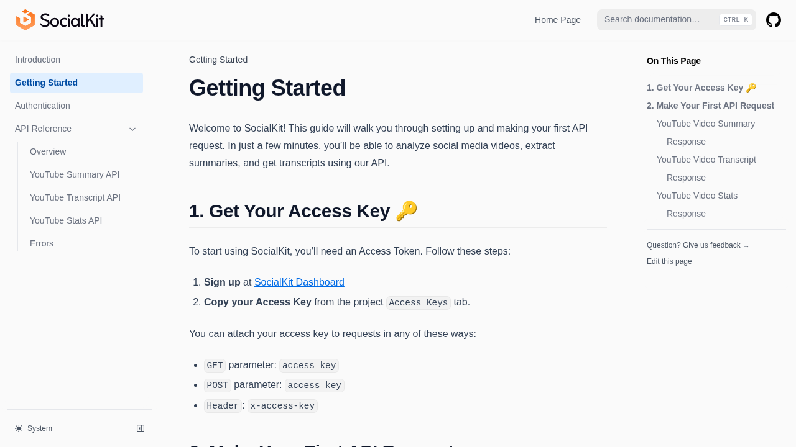
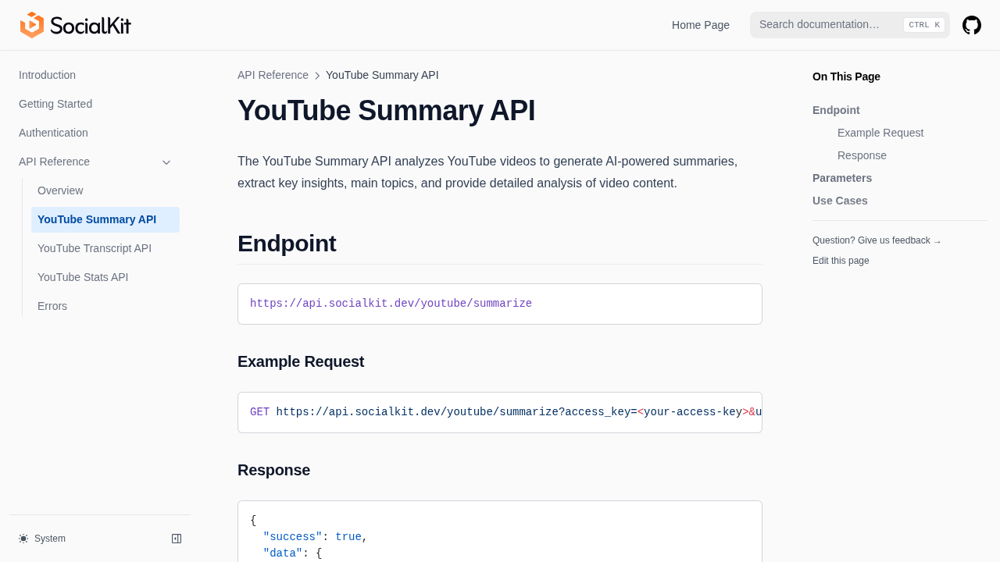
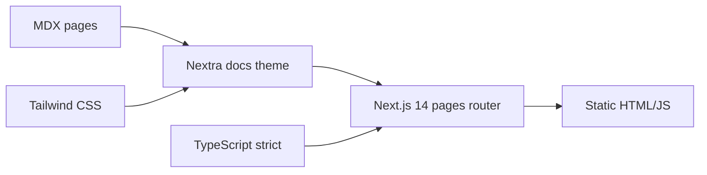

# SocialKit Documentation

Official documentation site for [SocialKit](https://www.socialkit.dev): a developer API for analyzing social media
videos (summaries, transcripts, engagement stats). Built with Next.js, Nextra, and Tailwind CSS.

[](https://github.com/unchain0/socialkit/actions/workflows/ci.yml)
[](./LICENSE)
[](https://nodejs.org/)
[](https://www.typescriptlang.org/)
[](https://yarnpkg.com/)






## Project sheet

| Field  | Value                                     |
| ------ | ----------------------------------------- |
| Goal   | Host SocialKit API docs as a static site  |
| Status | Active documentation                      |
| Stack  | Next.js 14 · Nextra 3 · TypeScript · Yarn |
| URL    | https://www.socialkit.dev                 |

## Features

- Video summaries with key insights, topics, tone, and quotes
- Timestamped transcripts for analysis and accessibility
- Custom AI analysis fields and prompts
- Live video stats (views, likes, comments, channel)
- Multi-platform roadmap (YouTube first; TikTok and Instagram planned)
- REST-focused docs with multiple auth methods

## Quick start

### Prerequisites

- Node.js ≥ 20 (`nvm use` reads `.nvmrc`)
- Yarn 1.22+

### Install and run

```bash
git clone https://github.com/unchain0/socialkit.git
cd socialkit
yarn install --frozen-lockfile
yarn dev
```

Open http://localhost:3000.

### Scripts

| Command              | Description                                |
| -------------------- | ------------------------------------------ |
| `yarn dev`           | Development server                         |
| `yarn build`         | Production build (outputs to `out/`)       |
| `yarn start`         | Serve production build (`serve out`)       |
| `yarn lint`          | ESLint (zero warnings)                     |
| `yarn complexity`    | Complexity and file/function size limits   |
| `yarn typecheck`     | TypeScript strict check                    |
| `yarn test`          | Unit tests (Vitest)                        |
| `yarn test:coverage` | Tests with ≥90% branch coverage thresholds |
| `yarn format:check`  | Prettier check                             |
| `yarn verify`        | Format + lint + types + coverage           |
| `yarn audit`         | Dependency audit (high/critical gate)      |

## Usage

Pages live under `pages/` as MDX:

- `pages/index.mdx` — Introduction
- `pages/getting-started.mdx` — First request
- `pages/authentication.mdx` — Access keys
- `pages/api-reference/` — Endpoint reference

Theme and SEO: `theme.config.jsx`. Next.js config: `next.config.mjs` (static export + security headers).

## Architecture



## Development standards

- **TypeScript**: `strict`, `noUncheckedIndexedAccess`, `noImplicitOverride`, `noPropertyAccessFromIndexSignature`
- **ESLint**: type-checked rules for TS, React, import order, jsx-a11y, complexity ≤ 10, max 50 lines/function, max 400
  lines/file, warnings as errors
- **RNG / IDs**: `Math.random` is lint-banned; use `lib/uuid.ts` (`uuidv7` via `crypto.getRandomValues`)
- **Tests**: Vitest + Testing Library; CI enforces 90% branch coverage on covered modules
- **Dependencies**: lockfile required; Renovate opens PRs (automerge patch only); OSV-Scanner + npm audit in CI
- **Secrets**: Gitleaks in CI; no secrets in the repo

```bash
yarn verify
yarn complexity
yarn test:coverage
yarn audit
```

## CI/CD

Workflow: `.github/workflows/ci.yml` on every push and PR to `main`.

| Job                  | Purpose                         |
| -------------------- | ------------------------------- |
| Lint                 | ESLint + Prettier               |
| Complexity           | Complexity and size limits      |
| Type Check           | `tsc --noEmit`                  |
| Tests                | Vitest with coverage thresholds |
| Build                | Next.js production build        |
| Dependency Audit     | npm audit gate + OSV-Scanner    |
| Secret Scan          | Gitleaks                        |
| Actionlint           | Workflow lint                   |
| Zizmor               | Actions security audit          |
| Conventional Commits | commitlint on PR range          |

Guarantees: `permissions.contents: read`, concurrency cancel-in-progress, full commit-SHA action pins, `timeout-minutes`
on every job, GitHub-hosted `ubuntu-latest`, no `continue-on-error`.

## Deployment

The site is configured for static export (`output: 'export'` in `next.config.mjs`). Running `yarn build` generates a
self-contained `out/` directory suitable for any static host (GitHub Pages, Netlify, Cloudflare Pages, etc.).

By default, the build targets **root deployment** (e.g., custom domain `https://www.socialkit.dev`) with no `basePath`
or `assetPrefix`. Internal links and `_next` assets resolve at the domain root.

### GitHub Pages project site

For GitHub Pages project site deployment (e.g., `https://<user>.github.io/socialkit`), explicitly set the environment
variables at build time:

```bash
NEXT_PUBLIC_BASE_PATH='/socialkit' NEXT_PUBLIC_ASSET_PREFIX='/socialkit' yarn build
```

### Custom project path

For a different subpath, adjust the env vars accordingly:

```bash
NEXT_PUBLIC_BASE_PATH='/my-project' NEXT_PUBLIC_ASSET_PREFIX='/my-project' yarn build
```

Security headers (CSP, HSTS, X-Frame-Options, etc.) are **not included in the static export** (Next.js does not apply
custom headers to static output). Configure equivalent headers on your hosting platform (e.g., `_headers` file for
Netlify, `Headers` for Cloudflare Pages, or web server config).

## Contributing

1. Fork and branch from `main` (`feat/…`, `fix/…`, `chore/…`)
2. Keep changes covered by `yarn verify`
3. Use [Conventional Commits](https://www.conventionalcommits.org/)
4. Open a PR against `main`

## License

MIT. See [LICENSE](./LICENSE).

## Contact

- Product site: https://www.socialkit.dev
- API base: `https://api.socialkit.dev`
- Issues: https://github.com/unchain0/socialkit/issues
