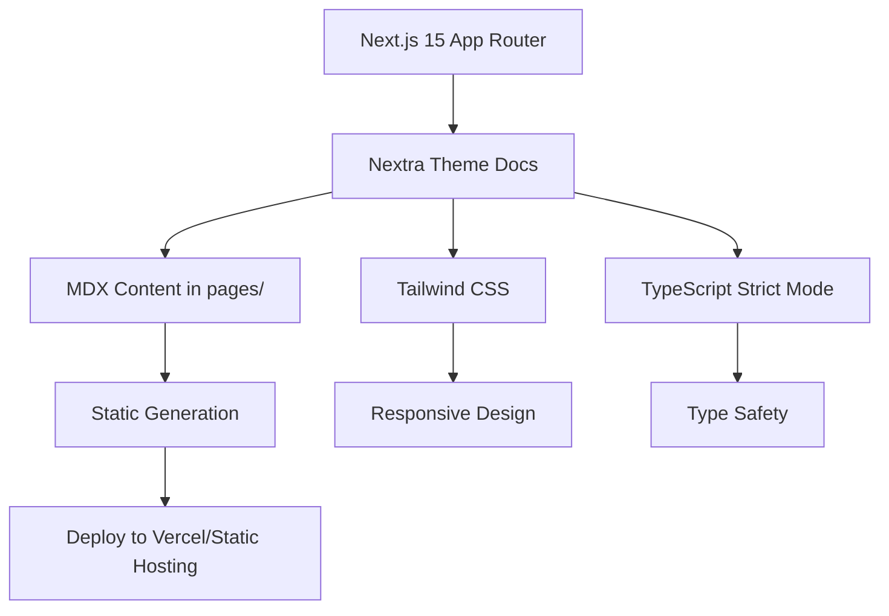

# SocialKit Documentation

The official documentation site for [SocialKit](https://www.socialkit.dev) — a powerful API for analyzing social media
videos. Built with Next.js 15, Nextra, and Tailwind CSS.


## Badges

[](https://github.com/geiger01/socialkit-docs/actions/workflows/ci.yml)
[](https://opensource.org/licenses/MIT)
[](https://nodejs.org/)
[](https://www.typescriptlang.org/)
[](https://nextjs.org/)

## Features

- **Video Summaries** — AI-powered summaries with key insights, main topics, tone analysis, and notable quotes
- **Video Transcripts** — Accurate transcripts with timestamped segments for content analysis and accessibility
- **Custom AI Analysis** — Define custom response fields and prompts for tailored insights
- **Video Stats** — Real-time engagement metrics: views, likes, comments, and channel information
- **Multi-Platform Support** — YouTube now, with TikTok and Instagram coming soon
- **Developer-First** — Simple REST API with multiple authentication methods

## Screenshots

### Documentation Home


### API Features Overview


## Quick Start

### Prerequisites

- Node.js ≥ 20.0.0
- Yarn ≥ 1.22.0

### Installation

```bash
# Clone the repository
git clone https://github.com/geiger01/socialkit-docs.git
cd socialkit-docs

# Install dependencies (uses frozen lockfile for reproducibility)
yarn install --frozen-lockfile

# Start development server
yarn dev
```

Visit `http://localhost:3000` to view the documentation site.

### Available Scripts

| Command             | Description                      |
| ------------------- | -------------------------------- |
| `yarn dev`          | Start development server         |
| `yarn build`        | Build for production             |
| `yarn start`        | Start production server          |
| `yarn lint`         | Run ESLint with zero warnings    |
| `yarn lint:fix`     | Auto-fix ESLint issues           |
| `yarn typecheck`    | Run TypeScript type checking     |
| `yarn format`       | Format code with Prettier        |
| `yarn format:check` | Check formatting without changes |
| `yarn check`        | Run format, lint, and typecheck  |
| `yarn audit`        | Run npm audit (high severity)    |
| `yarn audit:fix`    | Attempt to fix audit issues      |

## Usage

The documentation site is a static Next.js application that renders MDX content using Nextra. Pages are located in the
`pages/` directory:

- `pages/index.mdx` — Introduction
- `pages/getting-started.mdx` — Getting Started guide
- `pages/authentication.mdx` — Authentication documentation
- `pages/api-reference/` — API Reference pages

### Configuration

Key configuration files:

- `theme.config.jsx` — Nextra theme configuration (logo, navigation, SEO)
- `tailwind.config.js` — Tailwind CSS configuration
- `next.config.mjs` — Next.js configuration with Nextra plugin
- `tsconfig.json` — Strict TypeScript configuration

## Architecture



### Tech Stack

- **Framework**: Next.js 15 (React 18)
- **Documentation Theme**: Nextra (nextra-theme-docs)
- **Styling**: Tailwind CSS 3
- **Language**: TypeScript 5 (strict mode)
- **Linting**: ESLint 8 with TypeScript, React, Import, JSX-A11y plugins
- **Formatting**: Prettier 3
- **Package Manager**: Yarn 1 (Classic)

## Development

### Code Quality Standards

This project enforces strict engineering standards:

- **TypeScript**: Strict mode with `noUncheckedIndexedAccess`, `noImplicitOverride`,
  `noPropertyAccessFromIndexSignature`
- **ESLint**: Type-checked rules for `.ts/.tsx`, standard rules for `.js/.jsx`
- **Prettier**: Consistent formatting across all file types
- **Zero Warnings**: CI fails on any lint or type error
- **Cyclomatic Complexity**: Kept low via strict rules and small components

### Running Checks Locally

```bash
# Run all checks (format, lint, typecheck)
yarn check

# Or individually
yarn format:check
yarn lint
yarn typecheck
```

### Pre-commit Hooks

Install Husky for local pre-commit validation (optional but recommended):

```bash
npx husky install
npx husky add .husky/pre-commit "yarn check"
```

## CI/CD Pipeline

The GitHub Actions workflow (`.github/workflows/ci.yml`) runs on every push and PR:

| Job           | Description                        |
| ------------- | ---------------------------------- |
| `lint`        | ESLint + Prettier formatting check |
| `typecheck`   | TypeScript strict type checking    |
| `build`       | Next.js production build           |
| `audit`       | npm audit (high) + OSV-Scanner     |
| `secret-scan` | Gitleaks secret detection          |
| `actionlint`  | GitHub Actions workflow linting    |
| `zizmor`      | GitHub Actions security analysis   |

All jobs run on `ubuntu-latest` with:

- Least-privilege permissions (`contents: read`)
- Concurrency control with cancel-in-progress
- Action pins to full commit SHAs
- Timeout limits on every job

## Security

- **Dependencies**: Scanned via npm audit and OSV-Scanner in CI
- **Secrets**: Gitleaks runs in CI and can run locally via pre-commit
- **Headers**: CSP, HSTS, X-Frame-Options configured via Next.js
- **Input Validation**: All external data validated at boundaries

## Deployment

The site is designed for static export and can be deployed to:

- **Vercel** (recommended) — Zero-config deployment
- **Netlify** — Static site hosting
- **GitHub Pages** — Via Actions
- **Any static host** — `yarn build` outputs to `.next/`

### Vercel Deployment

[](https://vercel.com/new/clone?s=https%3A%2F%2Fgithub.com%2Fgeiger01%2Fsocialkit-docs&showOptionalTeamCreation=false)

Or connect your GitHub repository to Vercel for automatic deployments on push.

## Contributing

1. Fork the repository
2. Create a feature branch: `git checkout -b feat/your-feature`
3. Make changes with tests/docs updates
4. Run `yarn check` to validate
5. Commit using [Conventional Commits](https://www.conventionalcommits.org/)
6. Push and open a Pull Request

### Commit Message Format

```
<type>(<scope>): <description>

[optional body]

[optional footer]
```

Types: `feat`, `fix`, `docs`, `style`, `refactor`, `perf`, `test`, `chore`, `ci`

## License

This project is licensed under the MIT License — see [LICENSE](LICENSE) for details.

## Contact

- **Website**: [https://www.socialkit.dev](https://www.socialkit.dev)
- **API Base URL**: `https://api.socialkit.dev`
- **Issues**: [GitHub Issues](https://github.com/geiger01/socialkit-docs/issues)
- **Repository**: [github.com/geiger01/socialkit-docs](https://github.com/geiger01/socialkit-docs)
